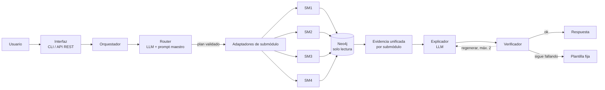

# Asistente Experto para la Selección Personalizada de Notebooks

> **Proyecto final · Inteligencia Artificial · Grupo 2 · Comisión 5K09 · UTN FRM · Ciclo 2026**
> Un único asistente que entiende preguntas en español, consulta una base de conocimiento en Neo4j, razona con reglas y lógica difusa, y explica sus conclusiones de forma verificable.

---

## 1. ¿Qué es?

Elegir una notebook no es comparar fichas técnicas: «16 GB» no significa lo mismo para ofimática que para máquinas virtuales, y «Core i7» no garantiza rendimiento sostenido. Este asistente traduce el **perfil de uso del comprador** en requisitos de hardware, evalúa cada notebook del catálogo y **justifica** por qué una quedó recomendada, condicionada, indeterminada o descartada.

Está formado por cuatro submódulos que comparten una única base de conocimiento:

| Submódulo | Responsabilidad | Autor |
| --- | --- | --- |
| **SM1** · Interpretación | Convierte el pedido del comprador en perfiles de uso con grado, presupuesto y requisitos | Olea, F. |
| **SM2** · Rendimiento y capacidad | Evalúa CPU, RAM y almacenamiento; riesgo de obsolescencia de la RAM (lógica difusa) | Miranda, M. (50101) |
| **SM3** · Gráfica y movilidad | Evalúa GPU, pantalla, peso y autonomía | de Coninck, R. |
| **SM4** · Integración y recomendación | Combina los grados, aplica los requisitos excluyentes y recomienda | Luconi Furque, M. *(confirmar)* |

> Legajos y contactos de los demás integrantes: `[completar]`.

## 2. Principios de diseño

1. **Neo4j maneja la verdad.** Toda cifra, regla, estado o alerta sale del grafo. El LLM no calcula ni decide.
2. **El LLM interpreta y explica, nada más.** Una llamada extrae la intención en JSON y otra redacta la respuesta a partir de una *evidencia* ya recuperada.
3. **El LLM no escribe Cypher.** Las consultas son plantillas fijas y parametrizadas, y la conexión es de **solo lectura** (`READ_ACCESS`).
4. **Todo se verifica en código.** Cada cifra, notebook y regla citada tiene que estar en la evidencia; si no, se regenera y, como último recurso, se usa una plantilla fija.
5. **La incertidumbre se conserva.** Un dato desconocido sigue siendo «desconocido» (no se convierte en «no ampliable»); un riesgo con rango se informa como rango; un pedido sin perfil definido no se «completa».
6. **Honestidad sobre la validación.** Los parámetros del modelo difuso están sin validar por un técnico: cada respuesta que dependa de ellos lo dice.

## 3. Arquitectura

> Propuesta para PG3, a acordar con el grupo. El flujo de SM2 (PI4) ya existe; el router y los adaptadores de SM1, SM3 y SM4 se construyen en PG3.



| Componente | Función |
| --- | --- |
| **Interfaz** | Entrada única: chat en terminal y API REST (`POST /consultar`, `GET /salud`) |
| **Orquestador** | Pre-valida la entrada, ejecuta el plan, une las evidencias y devuelve la traza completa |
| **Router + prompt maestro** | Decide a qué submódulo(s) va cada consulta; valida el plan contra el grafo; maneja fuera de alcance y aclaraciones |
| **Adaptadores SM1–SM4** | Cada uno valida sus parámetros, ejecuta sus consultas Cypher y devuelve evidencia normalizada |
| **Neo4j** | Base de conocimiento: perfiles, requisitos, notebooks, reglas REN / GM / REC / INT / FZ, parámetros, trazas |
| **Razonamiento** | Reglas y funciones de grado, e inferencia difusa tipo Mamdani (SM2) calculadas en el grafo |
| **Explicador + verificador** | Redacta con el LLM y comprueba la respuesta contra la evidencia |
| **Fuentes** | Intel ARK, AMD, Lenovo PSREF, requisitos oficiales de software, Notebookcheck, casos publicados (ver `docs/trazabilidad/`) |

## 4. Estructura del repositorio

```
SeleccionDeNotebooks_IA/
├── README.md
├── CHANGELOG.md                    # registro de cambios y depuración (actividad 1 de PG3)
├── CONTRIBUTING.md                 # ramas, commits, revisión y responsables por submódulo
├── requirements.txt                # dependencias de ejecución
├── requirements-dev.txt            # pytest, httpx, etc.
├── .gitignore                      # .env, __pycache__, logs, dumps pesados
│
├── config/
│   └── .env.example                # NEO4J_*, OLLAMA_* (copiar a .env)
│
├── prompts/                        # prompts versionados como texto
│   ├── maestro.md                  # System Prompt maestro: enrutamiento y límites
│   ├── extraccion_sm2.md           # (y uno por submódulo si hace falta)
│   └── explicacion.md
│
├── src/asistente/
│   ├── config.py                   # lectura de variables de entorno
│   ├── orquestador.py              # flujo maestro
│   ├── router.py                   # llamada 1 al LLM + validación del plan
│   ├── explicador.py               # llamada 2 al LLM + regeneración
│   ├── verificador.py              # cifras, IDs, atribución por notebook, semántica
│   ├── plantillas.py               # plantilla fija (REC-R11), aclaraciones, mensaje de alcance
│   ├── evidencia.py                # evidencia unificada con espacio por submódulo
│   ├── api.py                      # FastAPI
│   ├── cli.py                      # chat, --demo, --log
│   ├── clientes/
│   │   ├── llm.py                  # Ollama
│   │   └── grafo.py                # Neo4j en READ_ACCESS
│   └── submodulos/
│       ├── base.py                 # contrato común de los adaptadores
│       ├── sm1_interpretacion/
│       ├── sm2_rendimiento/        # partido desde Miranda_Mauricio_PI4_U4.py
│       ├── sm3_grafica_movilidad/
│       └── sm4_recomendacion/
│
├── cypher/
│   ├── carga/                      # Grupo_2_PG2_U1.cypher: esquema y datos de PG2
│   └── consultas/                  # consultas de lectura (una fuente de verdad): sm2_c2_riesgo_ram.cypher, ...
│
├── base_conocimiento/
│   ├── dump/                       # exportación de Neo4j (.dump)
│   └── datos_ejemplo/              # pedidos y notebooks de ejemplo
│
├── tests/
│   ├── unitarios/                  # offline: LLM y grafo simulados (no requieren Ollama ni Neo4j)
│   ├── integracion/                # requieren Neo4j cargado
│   └── e2e/
│       ├── casos_e2e.yaml          # consulta, submódulos esperados, resultado esperado
│       └── resultados/             # logs .jsonl de cada corrida (esperado vs obtenido)
│
├── scripts/
│   ├── cargar_grafo.py             # ejecuta cypher/carga/ contra Neo4j
│   ├── exportar_dump.py
│   ├── correr_demo.py              # casos de prueba documentados
│   └── empaquetar_zip.py           # arma Grupo_2_PG3_ProyectoFinal.zip
│
├── docs/
│   ├── informe/                    # informe ejecutivo final (fuente y PDF)
│   ├── diagramas/                  # arquitectura, flujo, red semántica (.mmd / .drawio / .png)
│   ├── casos_de_uso/               # al menos 5 integrales
│   ├── casos_de_prueba/            # esperado vs obtenido
│   ├── manual_de_uso/
│   ├── trazabilidad/               # fuente → regla → evidencia → consulta → explicación
│   ├── evaluacion/                 # fortalezas, limitaciones, errores, mejoras, reflexión metodológica
│   ├── contexto/                   # CONTEXTO_PROYECTO_SM2_PARA_PG3.md (ya subido) y notas de cada submódulo
│   └── historial/                  # PG0–PG2, PI1–PI4 de cada submódulo y correcciones de la profesora
│
└── presentacion/
    ├── video/
    └── infografia/
```

La carpeta `docs/` sigue el orden del informe y `scripts/empaquetar_zip.py` copia cada carpeta a su lugar en el ZIP de entrega (ver sección 10).

## 5. Requisitos

| Herramienta | Versión | Nota |
| --- | --- | --- |
| Python | 3.10 o superior `[confirmar]` | |
| Neo4j | 5.x | Las consultas usan subconsultas `EXISTS { … }` y el driver 5 (`execute_read`) |
| Ollama | reciente | Modelo por defecto: `llama3.1:8b` |
| Memoria | `[completar]` | Referencia de PI4: PC con Windows, corridas de 11 a 48 s por explicación |

## 6. Puesta en marcha

```bash
# 1. Clonar y crear el entorno
git clone https://github.com/Maaurimiranda/SeleccionDeNotebooks_IA.git
cd SeleccionDeNotebooks_IA
python -m venv .venv
source .venv/bin/activate            # Windows (PowerShell): .venv\Scripts\Activate.ps1
pip install -r requirements.txt

# 2. Configurar la conexión
cp config/.env.example .env          # y editar la contraseña de Neo4j

# 3. Cargar la base de conocimiento en Neo4j
python scripts/cargar_grafo.py       # ejecuta cypher/carga/Grupo_2_PG2_U1.cypher
#   alternativa: restaurar base_conocimiento/dump/ con neo4j-admin

# 4. LLM local
ollama serve
ollama pull llama3.1:8b

# 5. Ejecutar
python -m asistente.cli              # chat en la terminal
python -m asistente.cli --demo --log ejecuciones.jsonl
python -m asistente.cli --serve      # API REST en http://127.0.0.1:8000
```

### Variables de entorno

| Variable | Valor por defecto |
| --- | --- |
| `NEO4J_URI` | `bolt://localhost:7687` |
| `NEO4J_USER` | `neo4j` |
| `NEO4J_PASSWORD` | `neo4j` (cambiarla) |
| `NEO4J_DATABASE` | `neo4j` |
| `OLLAMA_URL` | `http://localhost:11434` |
| `OLLAMA_MODEL` | `llama3.1:8b` |

En PowerShell: `$env:NEO4J_PASSWORD="clave"`. No subir nunca el archivo `.env` al repositorio.

## 7. Uso

### Chat en terminal
Comandos: `/req req_02` (cambiar de pedido), `/traza` (mostrar u ocultar el detalle), `/ayuda`, `salir`.

### API REST
Contrato vigente desde PI4 (los campos de submódulos son una propuesta para PG3):

```bash
curl -X POST http://127.0.0.1:8000/consultar \
  -H "Content-Type: application/json" \
  -d '{"texto": "¿Qué riesgo de RAM tiene la Notebook K?", "requerimiento_id": "req_01"}'
```

| Campo de la respuesta | Contenido |
| --- | --- |
| `estado` | `ok`, `fuera_de_alcance`, `aclaracion` o `error` |
| `respuesta` | Texto final para el usuario |
| `origen_respuesta` | `LLM`, `plantilla fija (REC-R11)`, `regla fija`, `validación` o `error` |
| `evidencia`, `verificacion` | Lo que vio el LLM y el resultado de cada intento de verificación |
| `consulta` | Consulta Cypher ejecutada y sus parámetros |
| `submodulos_consultados` *(propuesto)* | Qué submódulos se usaron para responder |
| `segundos` | Duración |

`GET /salud` devuelve el estado de los submódulos, los modelos del catálogo y los pedidos cargados.

### Ejemplos de preguntas

| Pregunta | Submódulos que debería usar |
| --- | --- |
| «¿Qué riesgo corre cada notebook de quedarse corta de RAM?» | SM2 |
| «¿Qué notebooks se descartan porque no soportan virtualización?» | SM2 (y SM4 para el estado final) |
| «Explicame por qué la Notebook G quedó indeterminada» | SM2 + SM4 |
| «¿Qué reglas se activaron para la Notebook A?» | SM2 + SM3 + SM4 |
| «¿Qué riesgo de RAM tienen las notebooks para mi pedido?» (con `req_02`) | SM1 + SM2 (perfil indeterminado) |
| «¿Cuál es la capital de Francia?» | Ninguno: respuesta fija de alcance |

## 8. Pruebas

```bash
pip install -r requirements-dev.txt
pytest tests/unitarios               # offline, sin Neo4j ni Ollama
pytest tests/integracion             # requiere Neo4j cargado
pytest tests/e2e                     # requiere Neo4j y Ollama; guarda logs en tests/e2e/resultados/
```

| Nivel | Qué prueba |
| --- | --- |
| Unitarios | Validaciones, rechazo de respuestas inventadas, plantilla fija, errores controlados, API |
| Integración | Consultas Cypher contra el grafo: recuperación, reglas activadas, valores difusos |
| E2E | Consultas complejas que cruzan varios submódulos, con resultado esperado y obtenido |

Casos E2E candidatos *(a validar contra el grafo)*: explicar una recomendación completa (SM2 + SM3 + SM4), dato faltante que atraviesa módulos (Notebook G), perfil indeterminado (`req_02`), RAM y gráfica integrada (SM2 → SM3), y excluyentes con ranking (SM2 + SM4).

## 9. Trazabilidad y auditoría

Para cualquier respuesta se puede reconstruir:

1. **Pregunta** y JSON extraído por el LLM.
2. **Parámetros validados** contra el grafo.
3. **Consulta Cypher** ejecutada (plantilla fija con parámetros) y filas recuperadas.
4. **Evidencia** que recibió el LLM de explicación.
5. **Intentos de explicación** con los problemas que detectó el verificador, y el origen final de la respuesta.
6. **Regla y fuente**: las reglas activadas quedan en el grafo (`[:ACTIVA]`, con su fuerza) y cada regla enlaza con la fuente que la respalda.

El modo `--log archivo.jsonl` guarda todo eso para cada consulta.

## 10. Entregable PG3 (`Grupo_2_PG3_ProyectoFinal.zip`)

| Pedido de la consigna | Dónde está en el repo |
| --- | --- |
| a) Informe ejecutivo final (PDF) | `docs/informe/` |
| b) Diagramas | `docs/diagramas/` |
| c) Casos de prueba | `docs/casos_de_prueba/`, `tests/e2e/` |
| d) Manual de uso | `docs/manual_de_uso/` y la sección 7 de este README |
| e) Código fuente y `requirements.txt` | `src/`, `requirements.txt` |
| f) Scripts Cypher | `cypher/` |
| g) Archivos de configuración | `config/`, `prompts/` |
| h) Recursos complementarios | `scripts/`, `docs/historial/` |
| i) Exportación de Neo4j | `base_conocimiento/dump/` |
| j) Datos de ejemplo | `base_conocimiento/datos_ejemplo/` |
| k) Video o presentación | `presentacion/video/` |
| l) Infografía o resumen ejecutivo | `presentacion/infografia/` |

```bash
python scripts/empaquetar_zip.py     # genera Grupo_2_PG3_ProyectoFinal.zip
```

**Criterios de evaluación de PG3:** prompt maestro que enrute y respete que Neo4j maneja la verdad; API o interfaz única sin errores críticos; al menos tres pruebas E2E que crucen submódulos; informe coherente y profesional; ZIP que permita revisar y reproducir.

## 11. Estado del proyecto

- [x] Base de conocimiento en Neo4j (PG2)
- [x] SM2 integrado con LLM: flujo, prompts, verificador, plantilla fija y tests offline (PI4)
- [ ] SM2: verificación semántica (rangos, perfil indeterminado, afirmaciones sin respaldo) — **prioridad**
- [ ] SM2: confirmar la versión final del script de PI4 (ver `docs/contexto/`)
- [ ] Contrato común de adaptadores (`submodulos/base.py`)
- [ ] Adaptadores SM1, SM3 y SM4
- [ ] Prompt maestro y router
- [ ] API única con enrutamiento a varios submódulos
- [ ] Pruebas E2E (≥ 3) con esperado vs obtenido
- [ ] Informe, diagramas, manual, video e infografía
- [ ] Exportación de Neo4j y ZIP final

## 12. Limitaciones conocidas

- **Los parámetros del modelo difuso no están validados por un técnico.** Los resultados son una referencia, no una certeza.
- Las notebooks se nombran hoy con una sola letra (`Notebook_A` a `Notebook_Z`); el catálogo real prevé 30 modelos.
- Una intención por mensaje y un pedido activo por sesión.
- El verificador controla cifras, notebooks, reglas y atribución, pero todavía no el sentido de la frase.
- El extractor es un modelo local de 8 B: puede clasificar mal una consulta ambigua.

## 13. Cómo trabajamos

- **Ramas:** `main` (estable, siempre ejecutable), `dev` (integración) y una rama por tarea: `sm2/verificador-semantico`, `router/prompt-maestro`, etc.
- **Commits:** mensajes en imperativo y con prefijo del área (`sm2:`, `router:`, `docs:`, `tests:`).
- **Pull requests:** revisión de al menos otro integrante; los tests unitarios deben pasar.
- **Responsables:** cada submódulo tiene un dueño (sección 1); los cambios en `cypher/` y en `prompts/maestro.md` se acuerdan entre todos.
- **Registro:** todo cambio relevante va a `CHANGELOG.md`, porque PG3 pide documentar las correcciones realizadas.

## 14. Referencias

- Cátedra de Inteligencia Artificial, UTN FRM (2026). Unidad 4, apuntes U1a, U1b y U1e, y actividades PI1 a PI4 y PG0 a PG3.
- Neo4j, Inc. Cypher Manual y Neo4j Python Driver Manual. https://neo4j.com/docs
- Ollama. Documentación de la API y de salidas estructuradas. https://ollama.com
- Lewis, P. et al. (2020). *Retrieval-Augmented Generation for Knowledge-Intensive NLP Tasks*. NeurIPS 33.
- Zadeh, L. A. (1965). Fuzzy sets. *Information and Control*, 8(3). Mamdani, E. H. y Assilian, S. (1975). *International Journal of Man-Machine Studies*, 7(1).
- Fuentes de conocimiento de los submódulos: ver `docs/trazabilidad/` y los informes de `docs/historial/`.

## 15. Licencia y uso

Trabajo académico de la Cátedra de Inteligencia Artificial (UTN FRM). Uso educativo. `[definir licencia: el repositorio es público]`