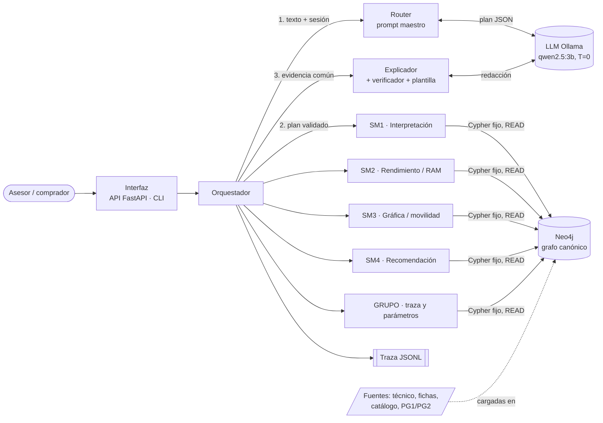
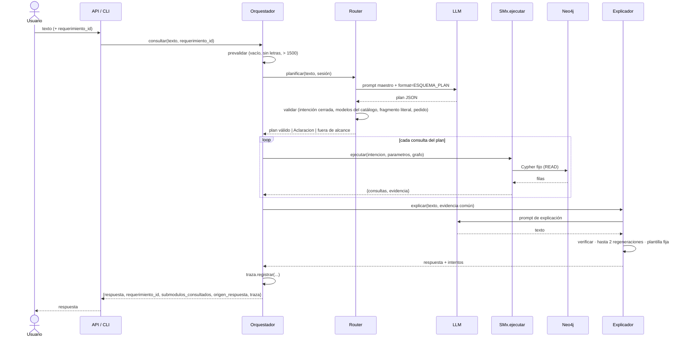

# Arquitectura del asistente (PG3)

> **Estado:** propuesta para implementar del 10/11 al 13/11/2026. Concreta el contrato de [D-07](INCONSISTENCIAS_CONTEXTOS.md#d-07--contrato-común-del-orquestador--resuelta-09112026) en código y en archivos.
> **Regla de oro:** si algo de este documento contradice una decisión D-01 a D-13, manda la decisión y se corrige este documento.
> **Plan de tareas:** [`docs/plan/PLAN_PG3.md`](plan/PLAN_PG3.md).

---

## 1. Principios (no negociables)

1. **Neo4j maneja la verdad.** Toda cifra, estado, regla y alerta sale del grafo. El LLM no calcula ni decide (consigna §7).
2. **El LLM interpreta y explica, en dos llamadas:** el router arma un plan JSON y el explicador redacta a partir de la evidencia. Nunca escribe Cypher.
3. **Las consultas son plantillas fijas** de cada submódulo, parametrizadas, en sesión `READ_ACCESS`. La única escritura es la de `SM1.registrar_pedido` y `SM1.aclarar_pedido` (nivel 2, D-08).
4. **Todo se verifica en código:** plan validado, cifras y modelos citados con respaldo en la evidencia y, si falla, plantilla fija.
5. **La incertidumbre se conserva:** rangos, `desconocida` y perfil `indeterminado` viajan intactos hasta la respuesta.
6. **Stack (D-05):** Python 3, `neo4j`, LangChain (`ChatOllama` de `langchain-ollama` y `ChatPromptTemplate` de `langchain-core`) contra Ollama `qwen2.5:3b` a temperatura 0 y salida estructurada (`with_structured_output`) en `asistente/llm.py`, y despacho a submódulos con `RunnableLambda` en `asistente/orquestador.py`; `requests` solo para la salud de Ollama; FastAPI + `uvicorn` y `unittest`. **Nada fuera de [`RESTRICCIONES.md`](RESTRICCIONES.md).**

## 2. Diagrama de componentes



| Componente | Función | Archivo | Dueño |
| --- | --- | --- | --- |
| Interfaz | Entrada única: `POST /consultar`, `GET /salud` y consola | `asistente/api.py`, `asistente/cli.py` | Miranda |
| Orquestador | Prevalida la entrada, pide el plan, ejecuta las consultas, arma la evidencia común, llama al explicador y registra la traza | `asistente/orquestador.py` | Miranda |
| Router (prompt maestro) | Traduce la consulta a un plan JSON de intenciones cerradas y lo valida en Python | `asistente/router.py`, `prompts/maestro.txt` | Olea |
| SM1 | Pedido interpretado (L1): perfiles con grado, perfil dominante, intensidad y preguntas pendientes | `asistente/submodulos/sm1/`, `cypher/10_sm1.cypher` | Olea |
| SM2 | Riesgo de RAM (C2, difuso FZ-R1..R5) y virtualización (C1, REN-R1) | `asistente/submodulos/sm2/`, `cypher/20_sm2.cypher` | Miranda |
| SM3 | Búsqueda por gráfica, movilidad o mixta, y ficha de un modelo | `asistente/submodulos/sm3/`, `cypher/30_sm3.cypher` | de Coninck |
| SM4 | Recomendación, explicación de una notebook (L2), comparación y costo-beneficio | `asistente/submodulos/sm4/`, `cypher/40_sm4.cypher` | Luconi |
| GRUPO | Traza de reglas (L3) y parámetros sin validar (L4) | `asistente/submodulos/grupo/` | de Coninck |
| Explicador | Un único prompt de explicación (base SM4, voseo, ≤ 180 palabras), verificador común y plantilla fija | `asistente/explicador.py`, `prompts/explicacion.txt` | Luconi |
| Base de conocimiento | Grafo canónico de PG2, dividido por submódulo | `cypher/*.cypher`, `scripts/cargar_grafo.py` | Miranda (archivos comunes) y cada dueño (su archivo) |
| Traza | Un registro por consulta del usuario (D-07 §9) | `asistente/traza.py`, `trazas/*.jsonl` | Miranda |

### 2.1 Capas del backend

El backend sigue un esquema **controlador → servicio → repositorio**, con los **esquemas** (forma de los datos) aparte. Se dice «esquemas» y no «modelos» porque en el dominio «modelo» ya es la notebook (`Notebook_G`) y también el modelo del LLM.

| Capa | Sistema | Dentro de cada submódulo | Qué hace y qué **no** hace |
| --- | --- | --- | --- |
| **Controlador** | `api.py`, `cli.py` | `entrada.py` | Recibe, valida la entrada y despacha. Sin lógica ni Cypher |
| **Servicio** | `orquestador.py`, `router.py`, `explicador.py` | `servicio.py` | Coordina y arma la evidencia (redondeo, rangos, literales D-06). **No recalcula ni decide**: eso lo hace el Cypher |
| **Repositorio** | `grafo.py`, `llm.py` | `repositorio.py` | Acceso a datos: el Cypher fijo con `grafo.leer`. Es donde viven las reglas y el difuso |
| **Esquemas** | `contrato.py` y los modelos Pydantic de la API | `esquemas.py` | Forma de parámetros, evidencia y respuesta. En los submódulos, `TypedDict` (biblioteca estándar); Pydantic solo en la API |

Reglas:
- Una capa solo llama a la de abajo: `entrada` → `servicio` → `repositorio`. El servicio nunca tiene Cypher y el repositorio nunca arma evidencia.
- **No hay endpoints por submódulo.** La única entrada es `POST /consultar` (y la consola); todo pasa por el router, la traza y el explicador.
- El router y el explicador quedan como archivos únicos: son servicios transversales, no submódulos de dominio.

## 3. Flujo de una consulta



**Caminos cortos** (sin explicador): una entrada inválida devuelve `origen_respuesta = "validacion"`; `fuera_de_alcance` devuelve un mensaje fijo sin tocar el grafo; un plan con `aclaracion` devuelve la pregunta; si Neo4j u Ollama no responden, devuelve `"error"` con un mensaje fijo.

## 4. Contrato en código (lo que permite trabajar en paralelo)

Todo lo de esta sección queda en `asistente/contrato.py` (tarea PG3-01). **Nadie lo cambia sin PR aprobado por Miranda.**

### 4.1 Interfaz de cada submódulo

Cada submódulo es un **paquete** Python con la misma forma (§2.1) y **una sola función pública**, `ejecutar`, que exporta su `__init__.py`:

```
asistente/submodulos/smX/
├── __init__.py      # from .entrada import ejecutar  (nada más)
├── entrada.py       # ejecutar(): valida parámetros y despacha cada intención a su función de servicio
├── servicio.py      # una función por intención: pide filas al repositorio y arma la evidencia
├── repositorio.py   # CONSULTAS = {"C2": "MATCH ..."} y funciones que llaman a grafo.leer(...)
└── esquemas.py      # TypedDict de parámetros y evidencia de cada intención
```

```python
# asistente/submodulos/smX/repositorio.py
CONSULTAS: dict[str, str] = {"C2": "MATCH ...", ...}   # nombre -> Cypher fijo con $parametros

# asistente/submodulos/smX/entrada.py
def ejecutar(intencion: str, parametros: dict, grafo: "Grafo") -> dict:
    """Devuelve {"consultas": [Consulta, ...], "evidencia": dict}.
    Lanza contrato.Aclaracion(mensaje) si faltan datos (modelo inexistente, pedido sin evaluar...)."""
```

- `Consulta = {"nombre": "SM2.C2", "cypher": str, "parametros": dict, "filas": list[dict]}`. Va a la traza tal cual.
- `evidencia` es lo único que verá el explicador del submódulo. Reglas:
  - números como los devuelve el grafo, redondeados a 3 decimales;
  - rangos como `{"min": x, "max": y}`, nunca un solo número;
  - `desconocida`, `indeterminado` y los estados con sus **literales D-06**, sin tildes;
  - reglas como `{"id": "FZ-R3", "fuerza": 0.62, "validacion": "sin validar"}`;
  - alertas como `{"codigo": "REN-R10", "texto": "...", "notebook": "Notebook_G"}`. La notebook es obligatoria: la atribución la controla el verificador.
- Un submódulo **no importa a otro submódulo**. Si necesita algo de otro, lo lee del grafo (`Evaluacion`), que es la interfaz entre submódulos (D-10).

### 4.2 Intenciones y parámetros

| Intención | Parámetros (obligatorios · *opcionales*) | Consultas | Nivel |
| --- | --- | --- | --- |
| `SM1.interpretacion_pedido` | `requerimiento_id` | L1 | 1 |
| `SM1.registrar_pedido` | `texto` | alta + `REGLAS_SM1` + L1 | 2 |
| `SM1.aclarar_pedido` | `requerimiento_id`, `respuesta` | ídem | 2 |
| `SM2.riesgo_ram` | `requerimiento_id` · *`modelos`, `etiqueta` (`bajo`/`medio`/`alto`), `tipo_ram`* | C2 sobre `ev.*` | 1 |
| `SM2.virtualizacion` | `requerimiento_id` · *`modelos`* | C1 | 1 |
| `SM3.buscar` | `requerimiento_id`, `orden` (`grafica`/`movilidad`/`mixta`) · *`filtros`: `dedicada`, `gama_min`, `peso_max`, `bateria_min`, `srgb_min`* | unificada | 1 |
| `SM3.ficha` | `requerimiento_id`, `modelo` | por modelo | 1 |
| `SM4.recomendar` | `requerimiento_id` | Q1, Q2, Q3, Q6B | 1 |
| `SM4.explicar_notebook` | `requerimiento_id`, `modelo` | Q4 (L2) | 1 |
| `SM4.comparar` | `requerimiento_id`, `modelos` (2 o 3) | Q6, Q6B | 1 |
| `SM4.costo_beneficio` | `requerimiento_id` | Q7 | 1 |
| `GRUPO.traza_reglas` | `requerimiento_id`, `modelo` | L3 | 1 |
| `GRUPO.parametros` | — | L4 | 1 |

Los modelos se normalizan a `Notebook_X` antes de llamar a `ejecutar`. El router lo hace; el submódulo puede asumirlo.

### 4.3 Plan del router (salida del prompt maestro)

```json
{
  "requerimiento_id": "req_01",
  "consultas": [{"intencion": "SM2.riesgo_ram", "parametros": {"modelos": ["Notebook_G"]}}],
  "evidencia": [{"dato": "modelo", "fragmento": "la G"}],
  "fuera_de_alcance": false,
  "aclaracion": null
}
```

- Con `qwen2.5:3b`, el esquema que se pasa en `format` usa un `enum` con las 13 intenciones (`"SM2.riesgo_ram"`, …) y **`maxItems: 3`** en `consultas`. La intención va con su prefijo de submódulo en un solo campo; `validar()` acepta también la forma `{"sm": "SM2", "intencion": "riesgo_ram"}`.
- `validar()` rechaza:
  - intenciones fuera del `enum`;
  - modelos que no están en el catálogo;
  - un `fragmento` que no aparece literal en el texto;
  - un `requerimiento_id` que no está ni en el texto ni en la sesión.
- Si el plan no trae `requerimiento_id` y la sesión tampoco, devuelve `Aclaracion("¿Sobre qué pedido?…")`. **Nunca se asume `req_01`.**
- Python agrega siempre `SM1.interpretacion_pedido` (L1) si hay pedido, porque la evidencia común lo lleva en `pedido`.

### 4.4 Evidencia común y respuesta

```json
{"pedido": {...L1...}, "SM2": {...}, "SM4": {...}, "advertencia": "Los parámetros ... están sin validar por el técnico ..."}
```

`asistente.orquestador.Orquestador.consultar(texto, requerimiento_id=None) -> dict` devuelve:

```json
{"respuesta": "...", "requerimiento_id": "req_01", "submodulos_consultados": ["SM1","SM2"],
 "origen_respuesta": "llm|plantilla_fija|validacion|fuera_de_alcance|error", "intento": 1, "traza": {...}}
```

### 4.5 Servicios comunes

```python
# asistente/grafo.py
class Grafo:
    def leer(self, cypher: str, parametros: dict | None = None) -> list[dict]   # READ_ACCESS
    def escribir(self, cypher: str, parametros: dict | None = None) -> list[dict]  # solo SM1, nivel 2
    def catalogo(self) -> list[str]        # ["Notebook_A", ...]
    def pedidos(self) -> list[str]         # ["req_01", ...]
    def salud(self) -> dict

# asistente/llm.py
class LLM:  # envuelve ChatOllama (langchain-ollama); cadena ChatPromptTemplate | ChatOllama
    def json(self, sistema: str, usuario: str, esquema: dict, variables: dict | None = None) -> dict  # with_structured_output
    def texto(self, sistema: str, usuario: str, variables: dict | None = None) -> str               # temperature 0
    # con `variables`, `sistema` es plantilla de ChatPromptTemplate ({var}; llaves literales como {{ }})
    def salud(self) -> dict                                             # GET /api/tags con requests

# asistente/explicador.py
def explicar(texto: str, evidencia: dict, llm: LLM) -> dict   # {"respuesta","origen_respuesta","intentos":[{"texto","problemas"}]}
def verificar(respuesta: str, evidencia: dict) -> list[str]   # lista de problemas; vacía = OK
def plantilla_fija(evidencia: dict) -> str

# asistente/router.py
def planificar(texto: str, sesion: dict, llm: LLM, catalogo: list[str] | None = None, pedidos: list[str] | None = None) -> dict
def validar(plan: dict, texto: str, sesion: dict, catalogo: list[str], pedidos: list[str]) -> dict
```

Excepciones de `contrato.py`: `Aclaracion(mensaje)`, `FueraDeAlcance`, `ErrorGrafo` y `ErrorLLM`. El orquestador las traduce a `origen_respuesta`.

**Separación de responsabilidades** (lámina de la cátedra «Cada capa decide algo distinto»):

| Capa | Responsabilidad | En este proyecto |
| --- | --- | --- |
| Neo4j | Estructura | Grafo canónico: conceptos, instancias, relaciones y evidencias |
| Reglas | Infieren | Reglas crisp y difusas (Mamdani) en Cypher fijo, probadas con CP1–CP11 |
| RAG | Documenta | **Graph RAG**: la evidencia son las filas del Cypher fijo y el explicador cita reglas y nodos. Sin embeddings |
| Logs | Auditan | Traza JSONL: submódulo, parámetros, Cypher, filas, duración y respuesta |
| LLM | Interpreta | Router (plan JSON) y explicador (texto acotado a la evidencia) |
| LangChain | Coordina | `ChatPromptTemplate`, `with_structured_output` y despacho con `RunnableLambda`. Sin agentes ni *tool calling* |
| FastAPI | Expone y valida | Modelos Pydantic, `response_model` y OpenAPI en `/docs` |

Regla de diseño: el LLM conversa y explica; el conocimiento verificable sostiene la decisión.

### 4.6 Configuración (`.env`, ver `.env.example`)

| Variable | Valor por defecto |
| --- | --- |
| `NEO4J_URI` | `bolt://localhost:7687` |
| `NEO4J_USER` / `NEO4J_PASSWORD` / `NEO4J_DATABASE` | `neo4j` / — / `neo4j` |
| `OLLAMA_URL` | `http://localhost:11434` |
| `OLLAMA_MODEL` | `qwen2.5:3b` |
| `MAX_CARACTERES` | `1500` |
| `MAX_REGENERACIONES` | `2` |
| `DIR_TRAZAS` | `trazas` |

Se leen con `os.getenv`, sin `python-dotenv` (D-05). La consola y la API se lanzan con las variables ya exportadas; el manual dice cómo.

## 5. Base de conocimiento: el grafo dividido por dueño

El canónico [`docs/cypher/Grupo_2_PG2_U1_corregido.cypher`](cypher/Grupo_2_PG2_U1_corregido.cypher) se parte **sin cambiar su contenido** (PG3-02). La división es por dueño, para que cada uno edite solo su archivo:

| Archivo | Bloques del canónico | Dueño |
| --- | --- | --- |
| `cypher/00_esquema.cypher` | 0 limpieza · 1 índices · 2 frames | Miranda |
| `cypher/01_conocimiento.cypher` | 3 perfiles y requisitos · 4 variables difusas · 5 reglas y parámetros · 6 léxico y gamas | Miranda |
| `cypher/02_instancias.cypher` | 7 compradores y pedidos · 8 catálogo y `SALIDA_PI2` | Miranda |
| `cypher/10_sm1.cypher` | 9.a, 9.b, 10.a, 10.b | Olea |
| `cypher/15_evaluaciones.cypher` | 10.c.0 (una `Evaluacion` por pedido × notebook) | Miranda |
| `cypher/20_sm2.cypher` | 10.c.1, 10.c.2 | Miranda |
| `cypher/30_sm3.cypher` | 9.c, 9.d, 9.e, 10.d, 10.e | de Coninck |
| `cypher/40_sm4.cypher` | 10.f | Luconi |
| `cypher/90_verificacion.cypher` | 11 (C1–C3) · 12 (CP1–CP11) | Miranda |

- El bloque 13 (L1–L4) **no va a un `.cypher`**: pasa a los diccionarios `CONSULTAS` de Python (L1 a SM1, L2 a SM4, L3 y L4 a GRUPO).
- Las reglas nuevas de nivel 2 (D-04) se agregan **en el archivo del submódulo**, incluido el `MERGE` de su nodo `:Regla`, y no en `01_conocimiento`. Así nadie edita el archivo de otro.
- `scripts/cargar_grafo.py` ejecuta los archivos en orden numérico, sentencia por sentencia (separadas por `;` al final de línea, sin los comentarios `//`).
- `scripts/verificar_grafo.py` corre los CP de `90_verificacion` y compara contra los valores esperados de PG1/PG2 §9: es la regresión.

**Neo4j:** cada integrante usa el **suyo**, sea Neo4j Desktop 5.x local o una AuraDB Free personal, cargado con `cargar_grafo.py`. No hay una base compartida. Las credenciales van en `.env`, que nunca se sube: el repo es público.

## 6. Estructura del repositorio (final)

```
SeleccionDeNotebooks_IA/
├── asistente/                 # (e) código fuente
│   ├── config.py  contrato.py  grafo.py  llm.py
│   ├── router.py  orquestador.py  explicador.py  traza.py
│   ├── api.py  cli.py
│   └── submodulos/            # un paquete por submódulo, todos con la misma forma (§2.1), y comun.py (leer_consulta, redondear, rango)
│       ├── sm1/  sm2/  sm3/  sm4/  grupo/
│       │   └── __init__.py  entrada.py  servicio.py  repositorio.py  esquemas.py
├── prompts/                   # maestro.txt, explicacion.txt (versionados)
├── cypher/                    # (f) 00_…90_*.cypher
├── scripts/                   # cargar_grafo.py, verificar_grafo.py, generar_fixtures.py, correr_e2e.py, exportar_grafo.py, armar_zip.py
├── tests/                     # unittest: test_contrato, test_router, test_smX, test_explicador, test_api, test_e2e
│   ├── comun.py               # GrafoFalso, fixture(), requiere_neo4j
│   ├── datos/                 # consultas_router.csv
│   └── fixtures/              # SMx.intencion.json: filas reales del grafo + evidencia esperada (scripts/generar_fixtures.py)
├── datos/                     # (j) datos de ejemplo y (i) exportación CSV del grafo
├── docs/
│   ├── ARQUITECTURA.md  RESTRICCIONES.md  INCONSISTENCIAS_CONTEXTOS.md  MANUAL_DE_USO.md
│   ├── plan/                  # PLAN_PG3.md + issues/
│   ├── informe/               # una sección por archivo; se arma el PDF (a)
│   ├── diagramas/             # (b) .drawio + .png
│   ├── pruebas/               # (c) casos de uso, E2E con traza y funcionales esperado vs obtenido
│   ├── sesiones/              # explicación de cada sesión de trabajo, para el grupo
│   ├── consigna/  contexto/  cypher/ (PG2, histórico)  fuentes/ (PI4, histórico)
├── requirements.txt  .env.example  .gitignore  README.md  CLAUDE.md
```

`requirements.txt` (nivel 1): `neo4j`, `langchain-core`, `langchain-ollama`, `requests`, `fastapi`, `uvicorn` y `httpx` (este solo para `test_api`). Nada más.

## 7. Pruebas

| Nivel | Qué prueba | Necesita | Herramienta |
| --- | --- | --- | --- |
| Unitarias offline | `ejecutar()` de cada SM con un `Grafo` falso que devuelve las filas del fixture, `validar()` del router, `verificar()` y la plantilla | Nada | `unittest` |
| Grafo | Regresión CP1–CP11 contra los esperados de PG1/PG2 §9 | Neo4j | `scripts/verificar_grafo.py` |
| Funcionales (consigna §3.5) | Recuperación, consultas, reglas, difuso y respuesta, con esperado contra obtenido | Neo4j | `tests/test_smX.py` (clase `ConGrafo`, se saltea si no hay Neo4j) |
| E2E (consigna §7) | E2E-1, 2, 3, 5 y 8 de D-12, con la traza en el formato de la cátedra | Neo4j + Ollama | `scripts/correr_e2e.py`, que escribe `docs/pruebas/E2E-n.md` |

El criterio de aprobado de un E2E es **lo que dice el grafo** (estados, grados, puestos y alertas de D-12), no el texto del LLM. El texto se controla con el verificador y se documenta.

## 8. Traza (consigna §3.7)

Una línea JSON por consulta en `trazas/AAAA-MM-DD.jsonl` (en `.gitignore`), con la estructura de D-07 §9:

`{consulta_usuario, plan, validacion{observaciones, aclaracion}, consultas[{sm, nombre, cypher, parametros, filas}], evidencia, intentos[{texto, problemas}], respuesta, origen_respuesta, segundos}`

Con la traza y el grafo se reconstruyen las 5 cosas de la consigna:
- **regla:** `[:ACTIVA]` y L3;
- **fuente:** la propiedad `fuente` de reglas, variables, léxico y componentes (por ejemplo, `Bateria.fuente`, `Notebook.fuente_precio`). No hay nodos `:Fuente`;
- **evidencia:** la que vio el explicador;
- **consulta:** el Cypher con sus parámetros y filas;
- **explicación:** la respuesta con sus intentos.

## 9. Fuera del nivel 1

Queda en el plan como nivel 2, solo si sobra tiempo:
- pedido nuevo con escritura e inferencia por `$req` (D-08);
- las reglas de D-04;
- dos escenarios (D-09);
- `requisitos_explicitos` (D-10);
- `SALIDA_PI2` de los 7 perfiles y `req_04`/`req_05` (D-03, D-11);
- E2E-4, E2E-6 y E2E-7.

El informe lo declara como trabajo futuro, con su diseño ya documentado en los contextos.
