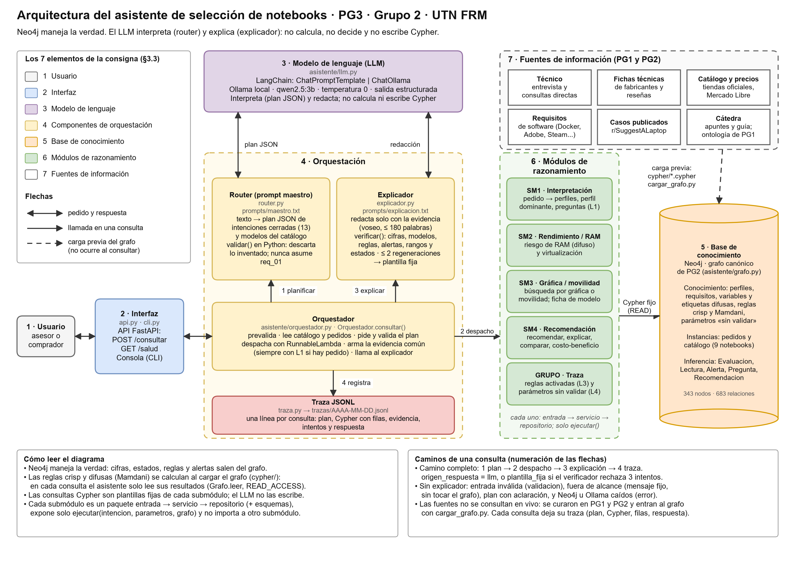

# Diagramas del asistente (PG3-10)

Ítem **b) Diagramas** del ZIP y figura de la consigna §3.3. Son tres, todos en hoja A4 apaisada.

| Diagrama | Editable | Imagen | Qué muestra |
| --- | --- | --- | --- |
| Arquitectura | [`arquitectura.drawio`](arquitectura.drawio) | [`arquitectura.png`](arquitectura.png) | Los 7 elementos de la consigna §3.3 y cómo se conectan |
| Secuencia de una consulta | [`secuencia_consulta.drawio`](secuencia_consulta.drawio) | [`secuencia_consulta.png`](secuencia_consulta.png) | El flujo de [`ARQUITECTURA.md`](../ARQUITECTURA.md) §3 con el ejemplo E2E-1 sobre `req_01` |
| Ontología del grafo | [`grafo.drawio`](grafo.drawio) | [`grafo.png`](grafo.png) | Los labels principales de Neo4j y sus relaciones |

## Cómo editarlos

1. Abrir el `.drawio` en [diagrams.net](https://app.diagrams.net) (o en la aplicación de escritorio). Está en la lista verde de [`RESTRICCIONES.md`](../RESTRICCIONES.md) (A3 y A4).
2. Cambiar lo que haga falta. Las cajas están dentro de contenedores (se mueven juntas) y las flechas están pegadas a las cajas.
3. **Archivo → Exportar como → PNG**, con la página A4 apaisada y zoom 250 %, y reemplazar el `.png` de esta carpeta.

Los `.png` que hay hoy **no** son una exportación de diagrams.net: se dibujaron con `matplotlib` a partir de la misma geometría que los `.drawio` y se compararon con el visor de diagrams.net, que los dibuja igual salvo detalles de tipografía. Si alguien edita un `.drawio`, tiene que reexportar su `.png`.

## 1. Arquitectura: los 7 elementos de la consigna §3.3

El diagrama numera cada elemento y le da su color. Los nombres coinciden con [`ARQUITECTURA.md`](../ARQUITECTURA.md) §2 y con el código.

| N.º | Elemento (§3.3) | Componente | Función | Archivo |
| --- | --- | --- | --- | --- |
| 1 | Usuario | Asesor o comprador | Escribe la consulta en español, por ejemplo «¿Qué me recomendás para req_01?». Puede fijar el pedido de la sesión | n/a |
| 2 | Interfaz | API FastAPI | Entrada única `POST /consultar` y `GET /salud`; valida con modelos Pydantic y documenta en `/docs`. No tiene lógica ni Cypher | [`asistente/api.py`](../../asistente/api.py) |
| 2 | Interfaz | Consola (CLI) | La misma entrada desde la terminal: consulta única o bucle, `/pedido req_01` para fijar el pedido y `--traza` para ver el plan y las consultas | [`asistente/cli.py`](../../asistente/cli.py) |
| 3 | Modelo de lenguaje | LLM | Cliente único de Ollama `qwen2.5:3b`, temperatura 0, con LangChain (`ChatPromptTemplate` y `ChatOllama`). `json()` devuelve el plan con salida estructurada y `texto()` redacta. **No calcula, no decide y no escribe Cypher** | [`asistente/llm.py`](../../asistente/llm.py) |
| 4 | Orquestación | Orquestador | Prevalida la entrada (vacía, sin letras, más de 1500 caracteres), lee catálogo y pedidos, pide el plan, agrega siempre `SM1.interpretacion_pedido` si hay pedido, despacha a cada submódulo con `RunnableLambda`, arma la evidencia común con la advertencia, llama al explicador y escribe la traza. Traduce las excepciones a `origen_respuesta` | [`asistente/orquestador.py`](../../asistente/orquestador.py) |
| 4 | Orquestación | Router (prompt maestro) | Convierte el texto en un **plan JSON** de intenciones cerradas (13, con un `enum`; hasta 3 consultas) y lo **valida en Python**: descarta intenciones, modelos y fragmentos inventados y nunca asume `req_01` | [`asistente/router.py`](../../asistente/router.py), [`prompts/maestro.txt`](../../prompts/maestro.txt) |
| 4 | Orquestación | Explicador | Redacta la respuesta solo con la evidencia (voseo, hasta 180 palabras). `verificar()` controla cifras, modelos, reglas, alertas, rangos y estados; regenera hasta 2 veces y, si no pasa, usa la **plantilla fija** | [`asistente/explicador.py`](../../asistente/explicador.py), [`prompts/explicacion.txt`](../../prompts/explicacion.txt) |
| 4 | Orquestación | Traza | Una línea JSON por consulta con el plan, la validación, el Cypher con sus filas, la evidencia, los intentos del verificador y la respuesta. Permite reconstruir regla, fuente, evidencia, consulta y explicación (consigna §3.7) | [`asistente/traza.py`](../../asistente/traza.py), `trazas/*.jsonl` (no se versiona) |
| 5 | Base de conocimiento | Neo4j (grafo canónico de PG2) | Guarda la verdad: perfiles, requisitos, variables y etiquetas difusas, reglas crisp y Mamdani, parámetros «sin validar», pedidos, catálogo y los resultados de la inferencia (`Evaluacion`). `Grafo.leer` abre la sesión en `READ_ACCESS` | [`asistente/grafo.py`](../../asistente/grafo.py), [`cypher/`](../../cypher/), `scripts/cargar_grafo.py` |
| 6 | Módulos de razonamiento | SM1 · Interpretación | Pedido interpretado: perfiles con grado, perfil dominante, intensidad y preguntas pendientes (`SM1.interpretacion_pedido`, consulta L1) | [`asistente/submodulos/sm1/`](../../asistente/submodulos/sm1/) |
| 6 | Módulos de razonamiento | SM2 · Rendimiento / RAM | Riesgo de quedarse corto de RAM (difuso, FZ-R1 a R5) y virtualización (`SM2.riesgo_ram`, `SM2.virtualizacion`) | [`asistente/submodulos/sm2/`](../../asistente/submodulos/sm2/) |
| 6 | Módulos de razonamiento | SM3 · Gráfica / movilidad | Búsqueda por gráfica, movilidad o mixta y ficha de un modelo (`SM3.buscar`, `SM3.ficha`) | [`asistente/submodulos/sm3/`](../../asistente/submodulos/sm3/) |
| 6 | Módulos de razonamiento | SM4 · Recomendación | Ranking, explicación de una notebook, comparación y costo-beneficio (`SM4.recomendar`, `explicar_notebook`, `comparar`, `costo_beneficio`) | [`asistente/submodulos/sm4/`](../../asistente/submodulos/sm4/) |
| 6 | Módulos de razonamiento | GRUPO · Traza | Reglas activadas para un pedido y una notebook (L3, con el origen de cada dato) y parámetros sin validar (L4) (`GRUPO.traza_reglas`, `GRUPO.parametros`) | [`asistente/submodulos/grupo/`](../../asistente/submodulos/grupo/) |
| 7 | Fuentes de información | Técnico, fichas, catálogo, requisitos de software, casos publicados y cátedra | Origen del conocimiento que se cargó al grafo en PG1 y PG2: entrevista al técnico, fichas de fabricantes (Intel ARK, AMD, NVIDIA, Lenovo PSREF) y reseñas, tiendas y Mercado Libre, requisitos oficiales (Docker, Adobe, Steam), casos de r/SuggestALaptop y apuntes de la cátedra. **No se consultan en vivo**: entran por `cypher/*.cypher` y `cargar_grafo.py` | [`docs/contexto/Contexto_PG1_PG2_Grupo_para_PG3.md`](../contexto/Contexto_PG1_PG2_Grupo_para_PG3.md) §4.3 |

Dos cosas que conviene tener presentes al explicarlo:

- **Quién razona.** Las reglas crisp y difusas se calculan **al cargar el grafo** (bloques 10.a a 10.f de `cypher/`). En cada consulta los submódulos solo **leen** esos resultados con Cypher fijo y de solo lectura. Por eso la flecha de los módulos a Neo4j es de lectura y la de las fuentes es una carga previa. Si entra el pedido nuevo con escritura (PG3-21, nivel 2), la arquitectura no cambia ([`ARQUITECTURA.md`](../ARQUITECTURA.md) §9), pero la flecha de SM1 a Neo4j pasaría a ser también de escritura (`Grafo.escribir`).
- **Cada submódulo** es un paquete `entrada` → `servicio` → `repositorio` (más `esquemas`), expone solo `ejecutar(intencion, parametros, grafo)` y no importa a otro submódulo ([`ARQUITECTURA.md`](../ARQUITECTURA.md) §2.1 y §4.1).

## 2. Secuencia de una consulta (E2E-1)

Consulta de ejemplo: «Para req_01, ¿qué notebook me recomendás? ¿Cómo andan de RAM y de gráfica?» ([`PG3-11`](../plan/issues/PG3-11.md)).

| Paso | Qué pasa |
| --- | --- |
| 1 | El usuario escribe en la API o en la consola; el orquestador prevalida y lee el catálogo y los pedidos de Neo4j |
| 2 | El router pide el plan al LLM con el prompt maestro y la salida estructurada, y lo valida en Python |
| 3 | El orquestador agrega `SM1.interpretacion_pedido` y recorre las consultas del plan: por cada una llama a `ejecutar`, el submódulo corre su Cypher fijo y devuelve `{consultas, evidencia}` |
| 4 | El explicador pide la redacción al LLM y la verifica (hasta 3 intentos); si ninguno pasa, usa la plantilla fija |
| 5 | El orquestador registra la traza y devuelve `{respuesta, requerimiento_id, submodulos_consultados, origen_respuesta, intento, traza}` |

**Qué es real y qué es ilustrativo.**

- Los valores de las cuatro vueltas salen de [`tests/fixtures/`](../../tests/fixtures/), que son filas reales del grafo: perfil dominante `VIRT` (0,899); `A` en el puesto 1 con 0,785, `H` y `B` empatadas y resueltas por REC-R8, `X` fuera de presupuesto, `M` condicionada, `E`, `C` y `K` descartadas, `G` indeterminada (D-12 pide `E` y `C`; el fixture suma `K`); riesgo de RAM de `G` como rango [49,58 ; 81,46]; adecuación gráfica de `C` 0,941.
- El **plan** (`SM4.recomendar`, `SM2.riesgo_ram`, `SM3.buscar`) es el esperado para esa pregunta, **no** una corrida registrada con Ollama. El orden de las vueltas depende del plan.
- La redacción del LLM no se muestra.

**Diferencias con el diagrama de `ARQUITECTURA.md` §3**, para que coincida con el código:

- Se agrega la lectura de `catalogo()` y `pedidos()` en Neo4j, que hace el orquestador antes de pedir el plan.
- En el código el orquestador llama a `router.planificar()` y después a `router.validar()`; en el diagrama las dos son del Router.
- Se muestra la regeneración del explicador como un bucle de hasta 3 intentos (`1 + MAX_REGENERACIONES`).

## 3. Ontología del grafo

Cinco capas, con un color cada una: pedido del comprador, conocimiento de dominio, inferencia, catálogo y reglas con lógica difusa. Las cajas son los **labels** de Neo4j; las flechas son las relaciones, con sus propiedades entre llaves.

Las relaciones se comprobaron contra los patrones de [`cypher/`](../../cypher/) (origen y destino de cada una). Las que no entran en el dibujo se listan en el mismo diagrama y acá:

| Relación | Origen → destino | Propiedades | En el dibujo |
| --- | --- | --- | --- |
| `FORMULA` | Comprador → Requerimiento | `fecha` | Sí |
| `INCLUYE` | Requerimiento → Actividad | | Sí |
| `APUNTA_A` | Actividad → Perfil | | Sí |
| `USA`, `EXPRESADA_COMO` | Actividad → Juego, ExpresionFrecuencia | | Nota |
| `RECOMIENDA_GAMA` | Juego → GamaGPU | `fuente` | Nota |
| `ES_DE_GAMA` | GPU → GamaGPU | | Nota |
| `PERTENECE` | Requerimiento → Perfil | `grado`, `origen`, `impone_requisitos`, `en_frontera` | Sí |
| `TIENE_PERFIL_DOMINANTE` | Requerimiento → Perfil | | Sí |
| `REQUIERE_ACLARACION` | Requerimiento → Pregunta | | Sí |
| `CONSULTA_POR` | Requerimiento → Notebook | | Nota |
| `EXIGE` | Perfil → Requisito | | Sí |
| `POSEE` | Notebook → CPU, RAM, Almacenamiento, GPU, Pantalla, Bateria | | Sí |
| `SALIDA_PI2` | Notebook → Perfil | `adecuacion_rendimiento`, `grado_pantalla`, `origen` | Sí |
| `EVALUA`, `SOBRE` | Requerimiento → Evaluacion → Notebook | | Sí |
| `TIENE_LECTURA` | Evaluacion → Lectura | `escenario` (`peor` o `mejor`) | Sí |
| `ACTIVA` | Evaluacion, Lectura → Regla (también Actividad, Requerimiento, Notebook, Recomendacion y SinAlternativaAdecuada) | `fuerza` | Sí, en parte |
| `GENERA` | Evaluacion → Alerta (también Requerimiento y Notebook) | | Sí, en parte |
| `PRODUCIDA_POR` | Alerta → Regla | | Sí |
| `RECIBE` | Requerimiento → Recomendacion (o SinAlternativaAdecuada) | | Sí, en parte |
| `PROPONE`, `PROPONE_FUERA_DE_PRESUPUESTO` | Recomendacion → Notebook | `orden` | Sí, en parte |
| `PERTENECE_A` | Actividad, Juego, Notebook, Bateria, GPU, Evaluacion, Lectura → EtiquetaDifusa | `grado`, `valor_crisp` | Nota |
| `TIENE_ETIQUETA` | VariableDifusa → EtiquetaDifusa | | Sí |
| `SE_PARAMETRIZA_CON` | EtiquetaDifusa → Parametro | | Sí |
| `VALIDA` | ConsultaExperto → Parametro, Regla | | Sí |
| `INCUMPLE`, `NO_VERIFICADO` | Notebook → Requisito | | No: solo las escribe la consulta de demostración C1 |
| `INSTANCIA_DE`, `POSEE_SLOT` | instancia → Frame, Frame → Frame | | Nota (esquema) |

Una captura de Neo4j Browser (`CALL db.schema.visualization()`) puede sumarse como complemento; hay que sacarla con el grafo cargado.
