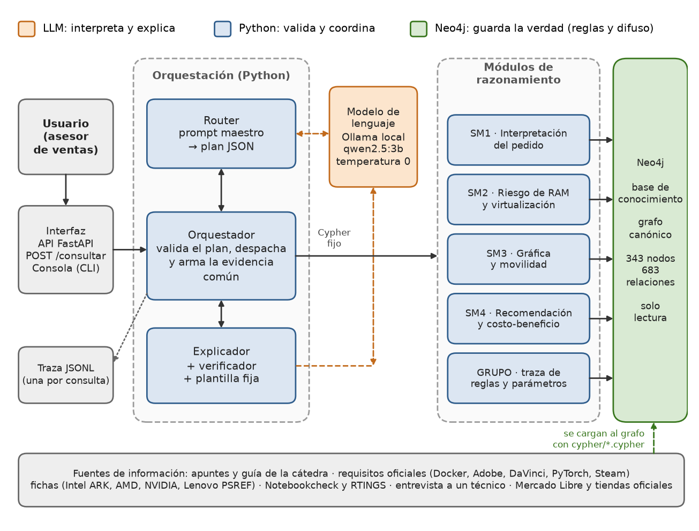
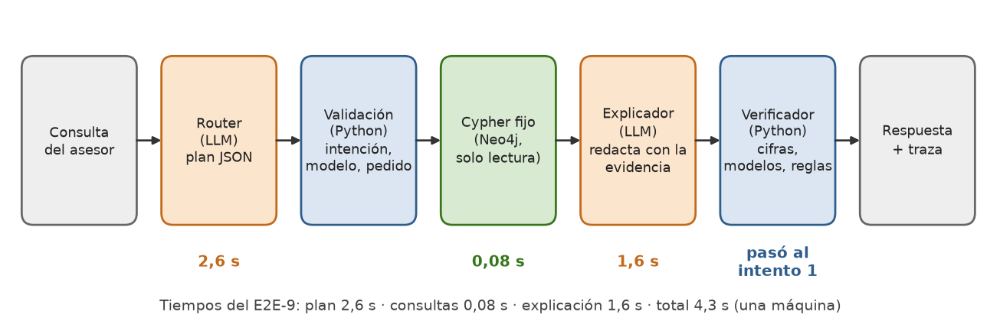

# 4. Arquitectura del sistema

La arquitectura completa está en `docs/ARQUITECTURA.md` (con su contrato en código, `asistente/contrato.py`). Esta sección resume lo que hace cada componente, cómo viaja una consulta y cómo se usa el sistema.

## 4.1 Principios de diseño

1. **Neo4j maneja la verdad.** Toda cifra, estado, regla y alerta sale del grafo. El LLM no calcula ni decide.
2. **El LLM interpreta y explica, en dos llamadas.** El router arma un plan JSON y el explicador redacta a partir de la evidencia. Nunca escribe Cypher.
3. **Las consultas son plantillas fijas**, parametrizadas y en sesión de solo lectura (`READ_ACCESS`). La única escritura prevista, `SM1.registrar_pedido` y `SM1.aclarar_pedido`, es de nivel 2 y **no está habilitada** (sección 9).
4. **Todo se verifica en código:** el plan, y después las cifras, modelos y reglas citados. Si la respuesta del LLM no pasa, se usa una plantilla fija.
5. **La incertidumbre se conserva:** rangos `{min, max}`, `desconocida` e `indeterminado` viajan intactos hasta la respuesta.
6. **Solo tecnologías vistas en la cátedra** (`docs/RESTRICCIONES.md`): Python, Neo4j, Cypher, Ollama, LangChain como cliente del LLM, FastAPI y `unittest`. Sin agentes, sin *tool calling*, sin embeddings.

## 4.2 Componentes



*Figura 1 · Arquitectura del sistema. Los colores indican quién decide: el LLM interpreta y explica, Python valida y coordina, Neo4j guarda las reglas y el difuso.*

| Componente | Función | Archivo |
| --- | --- | --- |
| Usuario | El asesor de ventas hace la consulta y recibe la explicación | — |
| Interfaz | Entrada única: `POST /consultar`, `GET /salud` y consola. Recibe, valida el formato y despacha; no tiene lógica ni Cypher | `asistente/api.py`, `asistente/cli.py` |
| Orquestador | Prevalida la entrada (vacía, sin letras, más de 1500 caracteres), pide el plan, ejecuta las consultas, arma la evidencia común, llama al explicador y registra la traza | `asistente/orquestador.py` |
| Router (prompt maestro) | Traduce la consulta a un plan JSON de intenciones cerradas y lo valida en Python: intención del conjunto, modelos del catálogo, fragmentos literales, pedido existente | `asistente/router.py`, `prompts/maestro.txt` |
| Modelo de lenguaje | `qwen2.5:3b` en Ollama local, temperatura 0, vía LangChain (`ChatPromptTemplate` y `ChatOllama` con salida estructurada) | `asistente/llm.py` |
| SM1 · Interpretación | Pedido interpretado: perfiles con grado, perfil dominante, intensidad gráfica, presupuesto y preguntas pendientes | `asistente/submodulos/sm1/` |
| SM2 · Rendimiento | Riesgo de RAM (difuso, FZ-R1 a FZ-R5) y virtualización como requisito excluyente | `asistente/submodulos/sm2/` |
| SM3 · Gráfica y movilidad | Búsqueda por gráfica, movilidad o ambas, y ficha de un modelo | `asistente/submodulos/sm3/` |
| SM4 · Recomendación | Ranking, explicación por notebook, comparación y costo-beneficio | `asistente/submodulos/sm4/` |
| GRUPO | Traza de reglas activadas (con su origen) y parámetros sin validar | `asistente/submodulos/grupo/` |
| Explicador | Un único prompt de explicación en voseo, un verificador común (controles a a h) y la plantilla fija | `asistente/explicador.py`, `prompts/explicacion.txt` |
| Base de conocimiento | Grafo canónico de PG2, cargado desde `cypher/*.cypher` | `cypher/`, `scripts/cargar_grafo.py` |
| Traza | Una línea JSON por consulta, con plan, Cypher, filas, evidencia, intentos y tiempos | `asistente/traza.py` |

El diagrama de componentes y el de secuencia, en formato Mermaid, están además en `docs/ARQUITECTURA.md`. Los diagramas de Draw.io de la tarea PG3-10 no estaban hechos al redactar este informe (11/11/2026), por lo que las figuras de esta sección se dibujaron aparte.

## 4.3 Capas del backend

El backend sigue un esquema **controlador, servicio y repositorio**, con los esquemas (la forma de los datos) aparte. Cada submódulo repite la misma estructura en cuatro archivos.

| Capa | En el sistema | Dentro de cada submódulo | Regla |
| --- | --- | --- | --- |
| Controlador | `api.py`, `cli.py` | `entrada.py` | Recibe, valida y despacha; sin lógica ni Cypher |
| Servicio | `orquestador.py`, `router.py`, `explicador.py` | `servicio.py` | Arma la evidencia (redondeo, rangos, literales); no recalcula ni decide |
| Repositorio | `grafo.py`, `llm.py` | `repositorio.py` | Acceso a datos: el Cypher fijo, donde viven las reglas y el difuso |
| Esquemas | `contrato.py`, modelos Pydantic de la API | `esquemas.py` | Forma de parámetros, evidencia y respuesta |

Una capa solo llama a la de abajo, un submódulo **no importa a otro** (se hablan a través del grafo, donde cada evaluación es un nodo `Evaluacion`) y **no hay endpoints por submódulo**: toda consulta pasa por el router, la traza y el explicador.

## 4.4 Flujo de una consulta



*Figura 2 · Flujo de una consulta con los tiempos reales del E2E-9 (plan 2604 ms, consultas 80 ms, explicación 1647 ms).*

1. **Prevalidación.** Una entrada vacía, sin letras o de más de 1500 caracteres se contesta sin llamar al LLM (`origen_respuesta = "validacion"`).
2. **Plan.** El router le pide al LLM un JSON con hasta tres intenciones del conjunto cerrado. Python lo valida y descarta lo que no está en el catálogo o no aparece literal en el texto. Si falta el pedido, pregunta «¿Sobre qué pedido?»: nunca asume `req_01`.
3. **Consultas.** Cada intención se despacha a su submódulo, que ejecuta Cypher fijo y devuelve `{"consultas", "evidencia"}`. El orquestador agrega siempre `SM1.interpretacion_pedido` cuando hay pedido.
4. **Explicación.** El LLM redacta con la evidencia común. El verificador revisa la respuesta; si falla, se regenera hasta dos veces y después sale la plantilla fija.
5. **Respuesta y traza.** Se devuelve `{respuesta, requerimiento_id, submodulos_consultados, origen_respuesta, intento, traza}` y se guarda la traza.

**Caminos cortos, sin explicador:** la entrada inválida; `fuera_de_alcance`, que devuelve un mensaje fijo sin tocar el grafo (0,69 s en el E2E-8); un plan con aclaración; y un error de Neo4j u Ollama, que devuelve `origen_respuesta = "error"` con un mensaje fijo.

## 4.5 Contrato entre componentes

Cada submódulo expone **una sola función**: `ejecutar(intencion, parametros, grafo) -> {"consultas", "evidencia"}`. El router solo puede pedir estas intenciones:

| Submódulo | Intención | Qué responde |
| --- | --- | --- |
| SM1 | `interpretacion_pedido` | Qué pidió el comprador y cómo lo interpretó el sistema |
| SM2 | `riesgo_ram` | Riesgo de quedarse corto de RAM por notebook, como rango si falta la ampliabilidad |
| SM2 | `virtualizacion` | Si la CPU cumple el requisito excluyente |
| SM3 | `buscar` | Búsqueda ordenada por gráfica, movilidad o mixta, con filtros opcionales |
| SM3 | `ficha` | Ficha gráfica y de movilidad de un modelo |
| SM4 | `recomendar` | Ranking con estado, grado y alternativa fuera de presupuesto |
| SM4 | `explicar_notebook` | Lo que cumple, lo que no cumple, lo que falta verificar y las alertas de una notebook |
| SM4 | `comparar` | De dos a tres notebooks lado a lado |
| SM4 | `costo_beneficio` | Índice costo-beneficio de las recomendadas |
| GRUPO | `traza_reglas` | Reglas activadas para una notebook, con su fuerza y su origen |
| GRUPO | `parametros` | Parámetros sin validar |

El contrato define 13 intenciones, pero solo 11 están habilitadas: `SM1.registrar_pedido` y `SM1.aclarar_pedido` son de nivel 2 y el router las rechaza.

La **evidencia** es lo único que ve el explicador. Sus reglas: los números salen del grafo con tres decimales; los rangos viajan como `{"min", "max"}`, nunca como un solo número; `desconocida`, `indeterminado` y los estados llevan los literales de D-06 sin tildes; cada regla trae su fuerza y su estado de validación; y cada alerta trae la notebook a la que pertenece, porque la atribución la controla el verificador.

## 4.6 Base de conocimiento y fuentes de información

El grafo (Neo4j 5.26) tiene 343 nodos y 683 relaciones, con 28 labels y 29 tipos de relación. Se arma al cargar los archivos `cypher/NN_*.cypher`, uno por dueño, que reproducen el canónico de PG2 corregido. El detalle de la ontología está en la sección 5.

Las **fuentes de información** no se consultan en tiempo de ejecución: se volcaron al grafo al construirlo, como parámetros, etiquetas difusas, datos de fichas y precios. Son las que registró el grupo en PG1: apuntes y guía de la cátedra; requisitos oficiales (Docker, Adobe, DaVinci, PyTorch, Steam); fichas de fabricantes (Intel ARK, AMD, NVIDIA, Lenovo PSREF); Notebookcheck y RTINGS; una entrevista a un técnico; y precios de Mercado Libre y tiendas oficiales al 01/10/2026. El patrón es **Graph RAG sin embeddings**: la evidencia son las filas que devuelve el Cypher fijo, y el explicador cita reglas y nodos de ahí.

## 4.7 Interfaz y uso básico

El manual de uso completo está en el Anexo B (`docs/MANUAL_DE_USO.md`): instalación paso a paso en Windows, consultas de ejemplo, cómo leer una respuesta y errores comunes. Lo mínimo para usar el sistema:

**Requisitos.** Python 3, Neo4j 5.x, Ollama con el modelo `qwen2.5:3b` (`ollama serve`) y unos 4 GB de RAM libres para el modelo. Se copia `.env.example` a `.env`, se completa `NEO4J_PASSWORD` (nunca se versiona) y se exportan las variables antes de lanzar la consola o la API.

```bash
pip install -r requirements.txt
python -m scripts.cargar_grafo        # carga el grafo desde cypher/ (BORRA la base de ese Neo4j)
python -m scripts.verificar_grafo     # regresión CP1 a CP11
python -m asistente.cli "¿Qué me recomendás para req_01?"   # una consulta por consola
python -m asistente.cli --traza --pedido req_01              # modo interactivo, con la traza
uvicorn asistente.api:app             # API; documentación OpenAPI en /docs
python -m unittest                    # pruebas (con Neo4j y Ollama también corren las de integración)
```

`POST /consultar` recibe `{"texto": "...", "requerimiento_id": "req_01"}` (el pedido es opcional si el texto lo nombra) y devuelve la respuesta, el pedido, los submódulos consultados, el `origen_respuesta` (`llm`, `plantilla_fija`, `validacion`, `fuera_de_alcance` o `error`) y la traza completa. `GET /salud` informa el estado de Neo4j y de Ollama. Las preguntas que el sistema sabe responder son las 11 intenciones de la sección 4.5, sobre los pedidos cargados `req_01`, `req_02` y `req_03`.

## 4.8 Decisiones de diseño

- **Router con intenciones cerradas en lugar de Text-to-Cypher.** Dejar que un modelo de 3 mil millones de parámetros escriba Cypher habría roto «Neo4j maneja la verdad» y la garantía de solo lectura. El modelo elige entre 11 intenciones y Python valida.
- **Un verificador común en lugar de uno por submódulo.** Recorre la evidencia sin conocer la forma de cada submódulo, así que sumar uno nuevo no lo rompe.
- **Un contrato fijo y un submódulo por persona.** Permitió que cuatro integrantes trabajaran en paralelo; cambiarlo exige un PR aprobado por Miranda.
- **LangChain solo como cliente.** `ChatPromptTemplate`, `ChatOllama` y `RunnableLambda` para despachar; sin agentes. Es la única excepción registrada en `docs/RESTRICCIONES.md` §8 (el paquete `langchain-ollama`).
