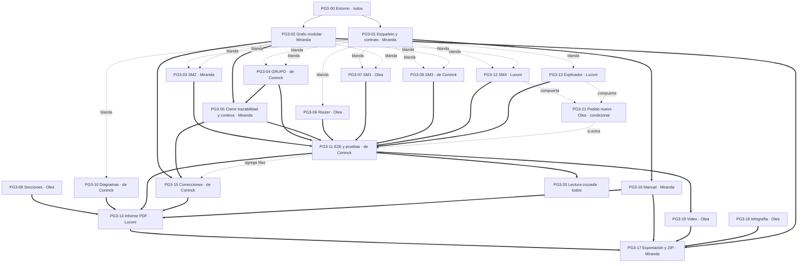

# Plan de PG3 · Grupo 2

> **Entrega:** viernes **13/11/2026** (`Grupo_2_PG3_ProyectoFinal.zip`).
> **Capacidad:** 4 personas × 3 h por día. Del martes 10 (noche) al viernes 13 hay unas **36 a 48 horas** en total.
> **Arquitectura:** [`docs/ARQUITECTURA.md`](../ARQUITECTURA.md). **Decisiones:** [`docs/INCONSISTENCIAS_CONTEXTOS.md`](../INCONSISTENCIAS_CONTEXTOS.md) (D-01 a D-13).
> **Stack del LLM (D-05, 10/11/2026):** LangChain (`ChatOllama` + `ChatPromptTemplate`) sobre Ollama, como en el ejemplo de PG3 de la cátedra. Lo implementa PG3-01 en `asistente/llm.py` (cliente) y `asistente/orquestador.py` (despacho con `RunnableLambda`); los submódulos no importan LangChain.
> **Capas del backend:** controlador → servicio → repositorio, más esquemas, en el sistema y dentro de cada submódulo (ARQUITECTURA §2.1). PG3-01 deja los cinco paquetes armados.
> **Estado (10/11, noche):** PG3-00 a PG3-04 y PG3-06 a PG3-09 están en `main` (PR #4, de Coninck). SM4 y el explicador siguen en stub. La revisión de ese avance contra la consigna y los ajustes de este plan están en [`docs/sesiones/2026-11-10_Miranda_PG3-00_validacion-y-ajustes.md`](../sesiones/2026-11-10_Miranda_PG3-00_validacion-y-ajustes.md).
> **Tareas:** una por archivo en [`issues/`](issues/), con el formato de un issue de GitHub, listas para crearse con `gh issue create --body-file`.

---

## 1. Cómo leer este plan

- **Nivel 1:** lo imprescindible para aprobar. Cubre cada criterio de evaluación de la consigna (§7) y cada ítem a–l del ZIP. Suma unas **44,5 h** (42 h del plan anterior, más 1,5 h de PG3-05 y 1 h de los dos casos integrales nuevos de PG3-11). **Ya hechas: ~27 h (el 10/11 se sumaron PG3-05, PG3-12, PG3-15 y casi todo PG3-13). Faltan unas 17 h.** El estado detallado y el prompt para seguir están en [`PROMPT_CONTINUACION.md`](PROMPT_CONTINUACION.md).
- **Condicional:** PG3-21 (pedido nuevo con inferencia en vivo). Se decide en una **compuerta** el miércoles (ver §2) y, si entra, se hace antes del congelamiento. Si no, se declara trabajo futuro.
- **Nivel 2:** si sobra tiempo. Son las mejoras de D-03, D-04, D-09, D-10 y D-11. Cada una está escrita como issue, así que se puede tomar cuando haya un hueco. Lo que no se haga se declara como **trabajo futuro** en el informe. Después del congelamiento del jueves no entra nada de nivel 2.
- **Asignación:**
  - Lo de cada submódulo va a su dueño: SM1 Olea, SM2 Miranda, SM3 de Coninck y SM4 Luconi.
  - Lo transversal va a quien tenía menos horas al repartir.
- **Dependencias:**
  - **dura:** no se puede empezar sin la otra;
  - **blanda:** se puede empezar contra el contrato de `ARQUITECTURA.md` §4 y los fixtures, y se integra después.

  Entre personas **solo hay dependencias blandas hasta el jueves**. Las duras aparecen recién en la integración (E2E, informe y ZIP).

## 2. Hitos

| Hito | Cuándo | Qué tiene que estar en `main` |
| --- | --- | --- |
| **H0 · Arranque** | Mar 10, 23:59 | Este plan, la arquitectura y `CLAUDE.md` unidos. Cada uno con Ollama `qwen2.5:3b`, Neo4j 5 propio y el canónico cargado (PG3-00). **Cumplido** |
| **H1 · Esqueleto** | Mié 11, 13:00 | PG3-01 (esqueleto ejecutable con stubs y contrato) y PG3-02 (grafo modular con la regresión CP1–CP11 en verde). **Cumplido el 10/11 (PR #4)** |
| **H2 · Módulos** | Mié 11, 23:59 | PG3-05, 10, 12 y 13 en `main`, con sus tests offline en verde; PG3-03, 04, 06, 07 y 09 ya están. **Compuerta de PG3-21** (ver abajo) |
| **H3 · Integración** | Jue 12, 20:00 | PR unidos, los 5 casos integrales (E2E-1, 2, 5, 9 y 10) y los 2 controles (E2E-3 y 8) corriendo de punta a punta (PG3-11). **Congelamiento de código a las 22:00**: después solo entran correcciones de bugs |
| **H4 · Textos** | Jue 12, 23:59 | Secciones del informe en `docs/informe/`, diagramas, manual y registro de correcciones |
| **H5 · Entrega** | Vie 13 | Informe PDF, video, infografía, exportación del grafo y ZIP subido |

**Compuerta de PG3-21 (Mié 11, apenas PG3-12 y PG3-13 estén en `main`).** Se toma PG3-21 solo si se cumplen las cuatro:
1. PG3-12 y PG3-13 en `main` y E2E-1 corriendo de punta a punta con el explicador real.
2. La regresión CP1–CP11 en verde (`python -m scripts.verificar_grafo`).
3. Olea libre para dedicarle 5 h.
4. Nadie tiene un E2E de los de arriba roto.

Si entra, PG3-21 **termina a más tardar el jueves a las 13:00**, para que los E2E del jueves corran sobre el código final. Si a esa hora no está, se descarta sin dejar nada a medias en `main` y el informe lo presenta como trabajo futuro (D-08). Es lo único que permite demostrar **inferencia en vivo** (consigna §1: «realizar inferencias»): sin ella, las reglas y el difuso corren al cargar el grafo y el asistente solo lee sus resultados.

## 3. Carga por persona (nivel 1)

| Persona | Submódulo | Hecho (PR #4) | Falta | Horas que faltan |
| --- | --- | --- | --- | --- |
| **Miranda, Mauricio** | SM2 | PG3-01 Esqueleto y contrato (3,5) · PG3-02 Grafo modular (2) · PG3-03 SM2 (2) | PG3-05 Cierre de trazabilidad y conteos (1,5) · PG3-16 Manual de uso (1) · PG3-17 Exportación y ZIP (1,5) · PG3-20 (0,5) | **4,5** |
| **Olea, Facundo** | SM1 | PG3-06 Router (3) · PG3-07 SM1 (2) · PG3-08 Secciones del informe (1,5) | PG3-18 Infografía (1,5) · PG3-19 Video (1,5) · PG3-20 (0,5). Condicional: PG3-21 (5) | **3,5** (8,5 con PG3-21) |
| **de Coninck, Ramiro** | SM3 | PG3-09 SM3 (2,5) · PG3-04 GRUPO (1) | PG3-10 Diagramas (2) · PG3-11 E2E, casos de uso y pruebas (4) · PG3-15 Registro de correcciones (1) · PG3-20 (0,5) | **7,5** |
| **Luconi, Martina** | SM4 | — | PG3-12 SM4 (3) · PG3-13 Explicador común (3) · PG3-14 Informe ejecutivo PDF (3) · PG3-20 (0,5) | **9,5** |
| **Todos** | — | PG3-00 Entorno (0,5 c/u) | — | — |

**Nivel 1 total: ~44,5 h; faltan ~25 h** (~30 h si entra PG3-21). Cabe en lo que queda de capacidad. Lo hecho el 10/11 lo hizo de Coninck en un solo PR, incluidas tareas de Miranda y Olea: esos dueños revisan su parte (PG3-05 y PG3-20). El camino crítico pasa casi entero por Luconi (SM4, explicador y PDF): conviene mirar su avance el miércoles al mediodía.

Si el miércoles a la noche (H2) alguien viene atrasado, se recorta primero PG3-21, después la infografía (la consigna pide «video **o** infografía»; si se recorta, el ítem l) se cubre con `02_resumen.md` en una página, ver PG3-18), después el manual separado (se lo puede reemplazar por el README) y por último el diagrama de secuencia.

## 4. Cronograma

| Bloque | Miranda (SM2) | Olea (SM1) | de Coninck (SM3) | Luconi (SM4) |
| --- | --- | --- | --- | --- |
| **Mar 10 noche** | Hecho en el PR #4: PG3-01, 02 y 03 | Hecho en el PR #4: PG3-06, 07 y 08 | Hecho en el PR #4: PG3-04 y 09 | Leer lo hecho · empezar PG3-12 |
| **Mié 11** | PG3-05 · revisar el PR #4 (`contrato.py`, D-05) · PG3-16 | Revisar router y SM1 · preparar PG3-21 · compuerta | PG3-10 · armar el script y los `.md` de PG3-11 contra los stubs | PG3-12 · PG3-13 |
| **Jue 12** | Revisar y unir los PR · integración | PG3-21 (hasta las 13:00, si pasó la compuerta) · ajustar el prompt con los E2E · PG3-20 | PG3-11 (E2E) · PG3-15 · PG3-20 | Ajustar el verificador con los E2E · secciones · PG3-20 |
| **Vie 13** | PG3-17 (exportación y ZIP) · PG3-20 | PG3-19 (video) · PG3-18 (infografía) | Repasar las pruebas y la traza final | PG3-14 (PDF final) |

## 5. Dependencias

Línea continua gruesa = dura. Punteada = blanda o condicional.

**Camino crítico:** PG3-12 y PG3-13 → PG3-11 → PG3-19 / PG3-14 → PG3-17. Lo que más riesgo tiene es PG3-11, porque junta todo. Para que no se trabe:
1. Cada módulo llega con sus tests offline en verde.
2. El orquestador del esqueleto ya corre de punta a punta con stubs. Integrar SM4 y el explicador es reemplazar su stub, nada más.
3. **Latencia:** con `qwen2.5:3b`, el plan tardó entre 10 y 50 s en la máquina de de Coninck, y el explicador suma otra llamada al LLM. Hay que medir los tiempos de punta a punta en las otras máquinas antes de grabar el video (PG3-19) y correr los E2E (PG3-11), y reportarlos en la sección de pruebas.

## 6. Reglas de trabajo

1. **Una rama por issue:** `pg3-NN-descripcion-corta`. PR a `main` revisado por **otro** integrante; el que tenga menos carga en ese momento. **El autor no une su propio PR.**
2. **Dueño por archivo** (ARQUITECTURA §2 y §5). Si hay que tocar un archivo ajeno, se le avisa al dueño y él revisa el PR. `asistente/contrato.py` lo revisa siempre Miranda.
3. **Definición de terminado**, para todas las tareas de código:
   - los criterios de aceptación tildados;
   - `python -m unittest` en verde;
   - sin credenciales en el diff;
   - la nota de sesión en `docs/sesiones/` (ver `CLAUDE.md`);
   - el PR unido.
4. **Literales:** los de D-06, sin tildes en el código y en el grafo.
5. **Tecnologías:** solo lo de `RESTRICCIONES.md`. Si algo no está, se frena y se avisa al grupo **antes** de usarlo, y la excepción de §8 la firma quien la aprobó.
6. **Entendimiento compartido** (prioridad del grupo): cada sesión de trabajo, con o sin IA, deja su explicación en `docs/sesiones/`. El jueves, cada uno lee las de los demás (PG3-20).

## 7. Cobertura de la consigna

| Consigna | Dónde se cumple |
| --- | --- |
| §2 Prompt maestro que enruta | PG3-06 |
| §2 API o interfaz única | PG3-01 (`POST /consultar`, CLI) |
| §2 y §7 Pruebas que cruzan submódulos (≥ 3 E2E) | PG3-11: los 5 casos integrales (E2E-1, 2, 5, 9 y 10), cada uno con ≥ 2 intenciones pedidas por el usuario |
| §3.1 Revisión, depuración y correcciones documentadas | PG3-02 (regresión), PG3-05 (conteos del grafo), PG3-15 |
| §3.2 Integración (Neo4j, reglas, difuso, LLM, interfaz) | PG3-01, 03, 04, 06, 07, 09, 12 y 13. La inferencia en vivo sobre un pedido nuevo es PG3-21 (condicional) |
| §3.3 Arquitectura y diagrama con la función de cada componente | `ARQUITECTURA.md`, PG3-10 |
| §3.4 ≥ 5 casos de uso integrados | PG3-11: E2E-1, 2, 5, 9 y 10 (los 5 cruzan submódulos). E2E-3 y E2E-8 son controles y no cuentan |
| §3.5 Pruebas funcionales con esperado y obtenido | PG3-03, 07, 09, 12 (funcionales por submódulo) y PG3-11 (documento) |
| §3.6 Evaluación del sistema | PG3-14 |
| §3.7 Trazabilidad (fuente, regla, evidencia, consulta, explicación) | PG3-01 (traza), PG3-04 (reglas), PG3-05 (fuente del conocimiento), PG3-11 (E2E-9) y PG3-14 (sección) |
| §3.8 Reflexión sobre la metodología | PG3-08 |
| §4 a) Informe PDF | PG3-14 |
| §4 b) Diagramas | PG3-10 |
| §4 c) Casos de prueba | PG3-11 |
| §4 d) Manual de uso | PG3-16 |
| §4 e) Código + `requirements.txt` | PG3-01 y los módulos |
| §4 f) Scripts Cypher | PG3-02 |
| §4 g) Configuración | PG3-01 (`.env.example`) |
| §4 h) Recursos complementarios | PG3-17 (prompts, contextos, fuentes PI4) |
| §4 i) Exportación de Neo4j | PG3-17 |
| §4 j) Datos de ejemplo | PG3-17 |
| §4 k) Video | PG3-19 |
| §4 l) Infografía o resumen ejecutivo | PG3-18 (y, si se recorta, `02_resumen.md` en una página) |

## 8. Lista de issues

### Nivel 1

✅ = hecho y en `main` (PR #4).

| ID | Título | Responsable | Horas | Depende de | Estado |
| --- | --- | --- | --- | --- | --- |
| [PG3-00](issues/PG3-00.md) | Entorno local igual para todos | Todos | 0,5 c/u | — | ✅ |
| [PG3-01](issues/PG3-01.md) | Esqueleto ejecutable, contrato y API | Miranda | 3,5 | PG3-00 | ✅ |
| [PG3-02](issues/PG3-02.md) | Grafo modular por dueño y regresión CP1–CP11 | Miranda | 2 | PG3-00 | ✅ (falta la tabla de conteos: PG3-05) |
| [PG3-03](issues/PG3-03.md) | SM2 en el contrato: riesgo de RAM y virtualización | Miranda | 2 | 01·, 02· | ✅ |
| [PG3-04](issues/PG3-04.md) | GRUPO: traza de reglas (L3) y parámetros (L4) | de Coninck | 1 | 01·, 02· | ✅ (falta la fuente: PG3-05) |
| [PG3-05](issues/PG3-05.md) | Cierre de PG3-02 y PG3-04: conteos del grafo y fuente en la traza | Miranda | 1,5 | 02, 04 | |
| [PG3-06](issues/PG3-06.md) | Prompt maestro y router | Olea | 3 | 01· | ✅ |
| [PG3-07](issues/PG3-07.md) | SM1 en el contrato: pedido interpretado | Olea | 2 | 01·, 02· | ✅ |
| [PG3-08](issues/PG3-08.md) | Informe: problema, integración con el LLM y metodología | Olea | 1,5 | 06, 07 | ✅ |
| [PG3-09](issues/PG3-09.md) | SM3 en el contrato: búsqueda y ficha | de Coninck | 2,5 | 01·, 02· | ✅ |
| [PG3-10](issues/PG3-10.md) | Diagramas de arquitectura, secuencia y grafo | de Coninck | 2 | 01· | |
| [PG3-11](issues/PG3-11.md) | E2E, casos de uso y pruebas funcionales documentadas | de Coninck | 4 | 02, 03, 04, 05, 06, 07, 09, 12, 13 | |
| [PG3-12](issues/PG3-12.md) | SM4 en el contrato: recomendar, explicar, comparar y costo-beneficio | Luconi | 3 | 01·, 02· | |
| [PG3-13](issues/PG3-13.md) | Explicador común: prompt, verificador y plantilla fija | Luconi | 3 | 01· | |
| [PG3-14](issues/PG3-14.md) | Informe ejecutivo final (PDF) | Luconi | 3 | 05, 08, 10, 11, 15, 16 | |
| [PG3-15](issues/PG3-15.md) | Registro de correcciones (consigna §3.1) | de Coninck | 1 | 02, 05; 11 (agrega filas) | |
| [PG3-16](issues/PG3-16.md) | Manual de uso | Miranda | 1 | 01 | |
| [PG3-17](issues/PG3-17.md) | Exportación del grafo, datos de ejemplo y ZIP final | Miranda | 1,5 | 02, 14, 16, 18, 19 | |
| [PG3-18](issues/PG3-18.md) | Infografía | Olea | 1,5 | 10, 11 | |
| [PG3-19](issues/PG3-19.md) | Video demostrativo | Olea | 1,5 | 11 | |
| [PG3-20](issues/PG3-20.md) | Lectura cruzada del sistema | Todos | 0,5 c/u | 11, 16 | |

`·` = dependencia blanda.

### Condicional (compuerta del miércoles)

| ID | Título | Responsable | Horas | Decisión |
| --- | --- | --- | --- | --- |
| [PG3-21](issues/PG3-21.md) | Pedido nuevo: registrar y aclarar, con inferencia por `$req` | Olea (+ Miranda revisa) | 5 | D-08, D-01 |

### Nivel 2 (si sobra tiempo, antes del congelamiento)

| ID | Título | Responsable | Horas | Decisión |
| --- | --- | --- | --- | --- |
| [PG3-22](issues/PG3-22.md) | SM1: requisitos explícitos, INT-R8/R9, entropía y dos escenarios | Olea | 4 | D-04, D-09, D-10 |
| [PG3-23](issues/PG3-23.md) | SM2: canal de memoria (REN-R11, REN-R14), REN-R13 y REN-R2 | Miranda | 3 | D-04 |
| [PG3-24](issues/PG3-24.md) | SM3: intensidad → gama (GM-R1/R2), GM-R14, GM-R15 y monitor externo (GM-R16) | de Coninck | 3 | D-04 |
| [PG3-25](issues/PG3-25.md) | `SALIDA_PI2` de los 7 perfiles, `req_04` y `req_05`, y E2E-4 | Miranda (rendimiento) + de Coninck (pantalla) | 3 + 2 | D-03, D-11 |
| [PG3-26](issues/PG3-26.md) | SM4: REC-R16 (monitor externo) y REC-R9 con `req_05` | Luconi | 2 | D-04, D-11 |
| [PG3-27](issues/PG3-27.md) | Contextos de SM3 y SM4 con etiquetas de procedencia | de Coninck, Luconi | 1 c/u | D-13 |
